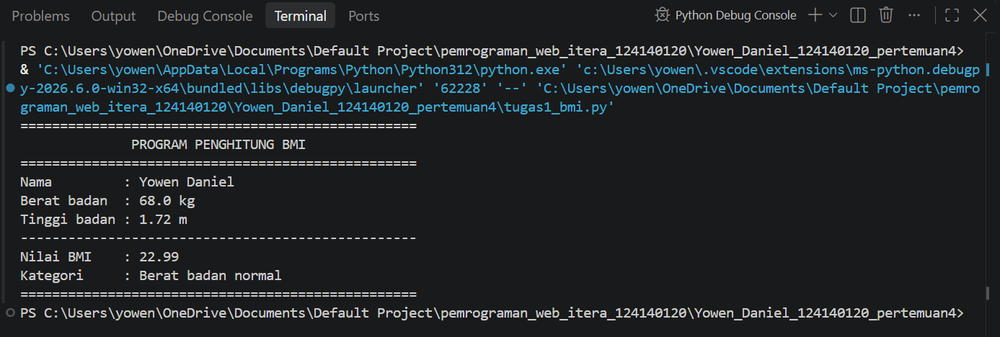
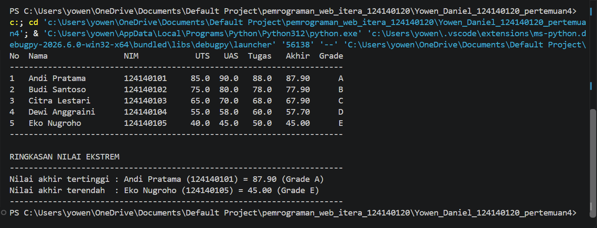
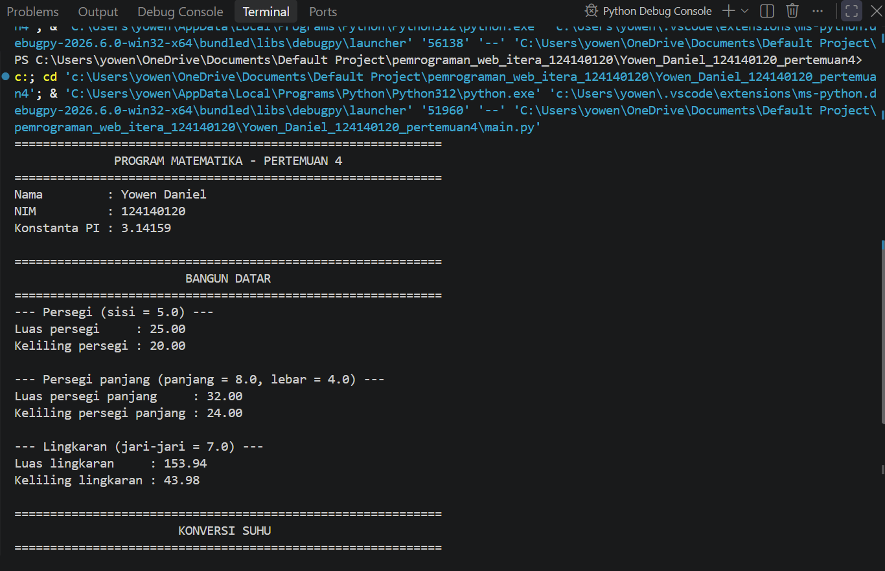
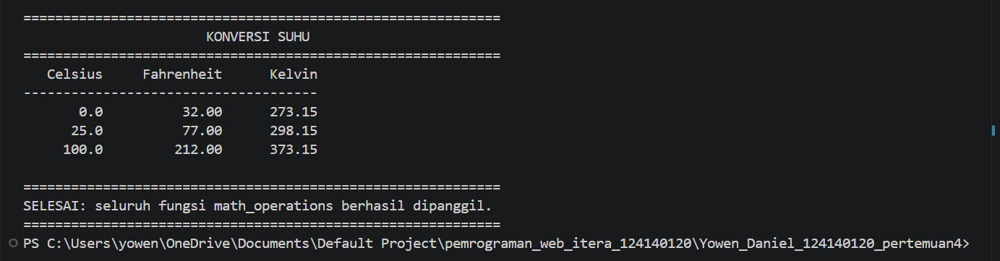

# Pertemuan 4 - Python Dasar

## Identitas Mahasiswa

| Keterangan | Data |
| --- | --- |
| Nama | **Yowen Daniel** |
| NIM | **124140120** |
| Mata Kuliah | Praktikum Pengembangan Aplikasi Web |
| Pertemuan | 4 - Python Dasar |

## Struktur Folder

```text
Yowen_Daniel_124140120_pertemuan4/
├── .gitignore
├── README.md
├── tugas1_bmi.py
├── tugas2_nilai_mahasiswa.py
├── math_operations.py
├── main.py
└── screenshots/
    ├── lanjutan_tugas3_math_operations.png
    ├── tugas1_bmi.png
    ├── tugas2_nilai_mahasiswa.png
    └── tugas3_math_operations.png
```

## Deskripsi Program

### 1. `tugas1_bmi.py` - Program Penghitung BMI (Bobot 30%)

Program menghitung nilai BMI (Body Mass Index) dari berat badan dalam
kilogram dan tinggi badan dalam meter menggunakan rumus:

```text
BMI = berat / (tinggi * tinggi)
```

Nilai BMI kemudian dikelompokkan dengan percabangan `if-elif-else`:

| Rentang BMI | Kategori |
| --- | --- |
| BMI < 18.5 | Berat badan kurang |
| 18.5 ≤ BMI < 25 | Berat badan normal |
| 25 ≤ BMI < 30 | Berat badan berlebih |
| BMI ≥ 30 | Obesitas |

Hasil perhitungan ditampilkan dengan format dua angka desimal menggunakan
f-string. Fungsi yang tersedia:

- `hitung_bmi(berat_kg, tinggi_m)` - menghitung nilai BMI.
- `kategori_bmi(bmi)` - menentukan kategori status berat badan.
- `tampilkan_hasil(nama, berat_kg, tinggi_m)` - mencetak hasil ke terminal.
- `main()` - menyiapkan data uji dan menjalankan program.

### 2. `tugas2_nilai_mahasiswa.py` - Data Nilai Mahasiswa (Bobot 40%)

Program menyimpan minimal lima data mahasiswa dalam bentuk list berisi
dictionary dengan kunci `nama`, `nim`, `nilai_uts`, `nilai_uas`, dan
`nilai_tugas`. Nilai akhir dihitung dengan rumus:

```text
Nilai Akhir = (30% * UTS) + (40% * UAS) + (30% * Tugas)
```

Grade ditentukan dengan ketentuan berikut:

| Nilai Akhir | Grade |
| --- | --- |
| ≥ 80 | A |
| 70 - 79.99 | B |
| 60 - 69.99 | C |
| 50 - 59.99 | D |
| < 50 | E |

Seluruh data ditampilkan dalam format tabel yang rapi, kemudian program
mencari dan menampilkan mahasiswa dengan nilai akhir tertinggi dan
terendah. Fungsi yang tersedia:

- `hitung_nilai_akhir(nilai_uts, nilai_uas, nilai_tugas)` - menghitung
  nilai akhir berbobot.
- `tentukan_grade(nilai_akhir)` - menentukan grade A sampai E.
- `olah_data_mahasiswa(daftar_mahasiswa)` - menambahkan nilai akhir dan
  grade ke setiap data.
- `tampilkan_tabel(daftar_mahasiswa)` - mencetak tabel nilai.
- `cari_nilai_tertinggi(daftar_mahasiswa)` - mencari nilai tertinggi.
- `cari_nilai_terendah(daftar_mahasiswa)` - mencari nilai terendah.
- `main()` - menjalankan seluruh alur program.

### 3. `math_operations.py` dan `main.py` - Modul Matematika (Bobot 30%)

`math_operations.py` adalah modul kustom yang berisi:

- Konstanta `PI = 3.14159`.
- Fungsi luas dan keliling untuk tiga bangun datar:
  `luas_persegi()`, `keliling_persegi()`,
  `luas_persegi_panjang()`, `keliling_persegi_panjang()`,
  `luas_lingkaran()`, dan `keliling_lingkaran()`.
- Fungsi konversi suhu: `celsius_ke_fahrenheit()` dan
  `celsius_ke_kelvin()`.

`main.py` adalah program utama yang memanggil seluruh fungsi tersebut
dengan berbagai nilai pengujian dan menampilkan hasilnya secara
terstruktur. Program ini menerapkan dua cara import yang berbeda:

```python
# Cara 1: mengimpor seluruh modul.
import math_operations
math_operations.luas_persegi(5)

# Cara 2: mengimpor fungsi tertentu secara langsung.
from math_operations import celsius_ke_fahrenheit, celsius_ke_kelvin
celsius_ke_fahrenheit(25)
```

## Cara Menjalankan Program

### Prasyarat

- Python 3.8 atau versi yang lebih baru sudah terpasang.
- Terminal atau Command Prompt, atau terminal terintegrasi VS Code.

### Langkah Menjalankan

1. Buka terminal, lalu masuk ke folder pertemuan ini:

   ```bash
   cd Yowen_Daniel_124140120_pertemuan4
   ```

2. Jalankan setiap skrip sesuai kebutuhan:

   ```bash
   # Soal 1: Program penghitung BMI
   python tugas1_bmi.py

   # Soal 2: Program pengelolaan nilai mahasiswa
   python tugas2_nilai_mahasiswa.py

   # Soal 3: Program utama modul matematika
   python main.py
   ```

   Pada macOS/Linux atau jika perintah `python` tidak dikenali, gunakan
   `python3`, misalnya:

   ```bash
   python3 tugas1_bmi.py
   ```

3. Apabila ingin memakai virtual environment (opsional):

   ```bash
   python -m venv venv

   # Windows (PowerShell)
   .\venv\Scripts\activate

   # macOS/Linux
   source venv/bin/activate
   ```

   Folder `venv/` dan `__pycache__/` sudah terdaftar pada `.gitignore`
   sehingga tidak akan ikut terunggah ke repositori.

## Bukti Hasil Eksekusi

### Soal 1 - Program Penghitung BMI



### Soal 2 - Program Pengelolaan Nilai Mahasiswa



### Soal 3 - Modul Matematika dan Program Utama



Lanjutan output program:


