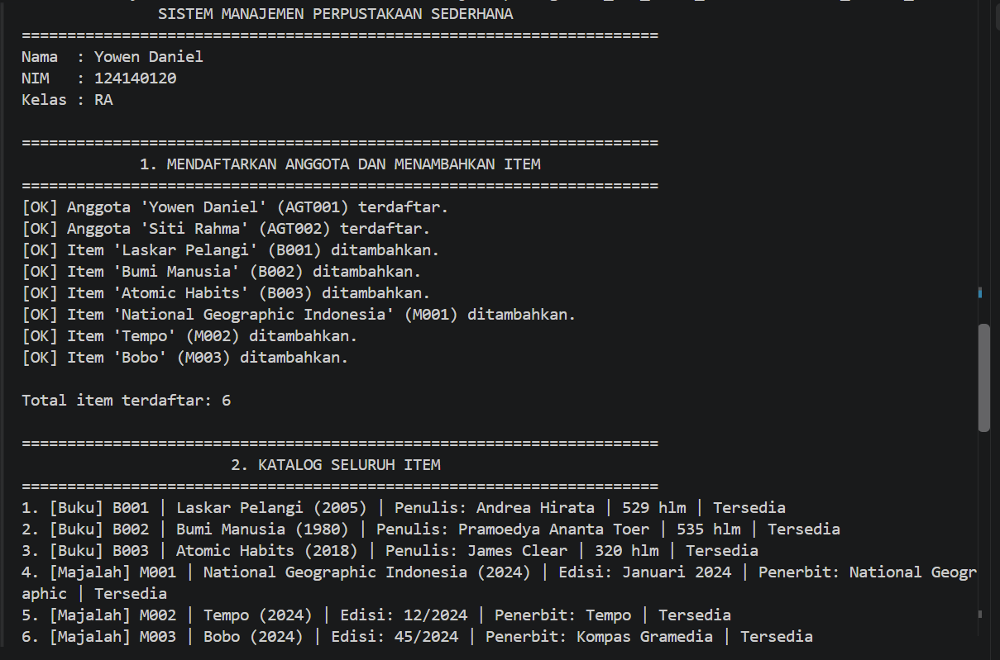
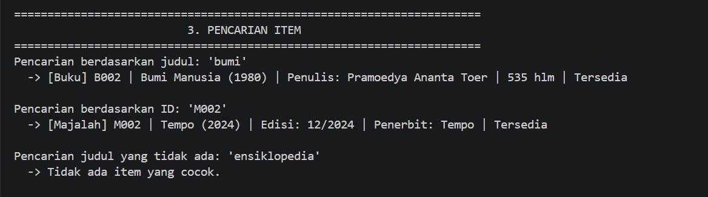
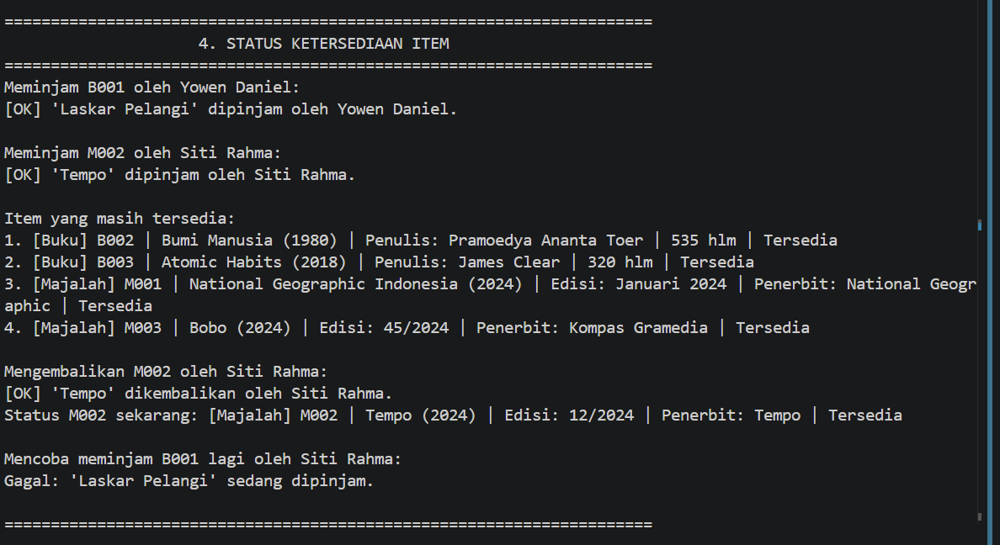
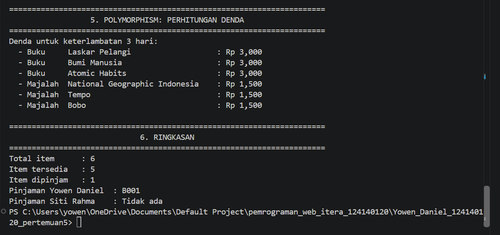

# Pertemuan 5 - Python OOP

## Identitas Mahasiswa

| Keterangan | Data |
| --- | --- |
| Nama Lengkap | **Yowen Daniel** |
| NIM | **124140120** |
| Kelas Praktikum | **RA** |
| Mata Kuliah | Praktikum Pengembangan Aplikasi Web |
| Pertemuan | 5 - Python Object-Oriented Programming |

## Struktur Folder

```text
Yowen_Daniel_124140120_pertemuan5/
├── .gitignore
├── README.md
├── latihan/
│   ├── 01_everything_is_object.py
│   ├── 01_procedural_vs_oop.py
│   ├── 02_class_object.py
│   ├── 03_inheritance.py
│   ├── 04_encapsulation.py
│   ├── 05_polymorphism.py
│   └── 06_abstract_class.py
├── tugas_perpustakaan/
│   ├── library_item.py
│   ├── member.py
│   ├── library.py
│   └── main.py
└── screenshots/
    ├── 01_tambah_dan_katalog.png
    ├── 02_pencarian.png
    ├── 03_status_dan_denda.png
    └── lanjutan_03_status_dan_denda.png
```

## Deskripsi Tugas: Sistem Manajemen Perpustakaan

Program simulasi perpustakaan sederhana yang menerapkan seluruh pilar
OOP Python. Alur program pada `tugas_perpustakaan/main.py`:

1. Membuat object `Library` dan mendaftarkan dua `Member`.
2. Menambahkan enam item koleksi (tiga `Book`, tiga `Magazine`).
3. Menampilkan seluruh katalog beserta status ketersediaannya.
4. Mencari item berdasarkan judul, berdasarkan ID, dan judul yang
   tidak ada (hasil kosong).
5. Meminjam item, menampilkan item yang masih tersedia, lalu
   mengembalikan salah satu item.
6. Menghitung denda keterlambatan untuk setiap item (polymorphism).
7. Menampilkan ringkasan jumlah item dan daftar pinjaman anggota.

### Penerapan 4 Pilar OOP

| Pilar | Penerapan pada kode |
| --- | --- |
| **Abstraction** | `LibraryItem(ABC)` memiliki dua method abstract, yaitu `get_detail()` dan `hitung_denda()`. Class ini tidak bisa diinstansiasi langsung. |
| **Inheritance** | `Book` dan `Magazine` mewarisi `LibraryItem` melalui `super().__init__()`, sehingga memperoleh atribut `item_id`, `judul`, `tahun`, dan status pinjam. |
| **Encapsulation** | Atribut sensitif diberi prefix `__` (name mangling), misalnya `Library.__koleksi`, `LibraryItem.__dipinjam`, dan `Member.__pinjaman`. Akses dari luar hanya melalui `@property`. |
| **Polymorphism** | `get_detail()` dan `hitung_denda()` di-override berbeda: buku Rp1.000/hari, majalah Rp500/hari. Method yang sama menghasilkan output berbeda sesuai tipe object. |

### Rincian Class

- **`LibraryItem`** (`library_item.py`) - abstract base class berisi
  `item_id`, `judul`, `tahun`, status `__dipinjam`, method
  `pinjam()`, `kembalikan()`, serta dua method abstract.
- **`Book`** (`library_item.py`) - subclass dengan atribut tambahan
  `penulis` dan `jumlah_halaman`. Denda Rp1.000 per hari.
- **`Magazine`** (`library_item.py`) - subclass dengan atribut
  tambahan `edisi` dan `penerbit`. Denda Rp500 per hari.
- **`Member`** (`member.py`) - menyimpan `member_id`, `nama`, dan
  daftar `__pinjaman` (dikembalikan sebagai tuple read-only).
- **`Library`** (`library.py`) - menyimpan `__koleksi` dan
  `__anggota` (keduanya private). Menyediakan `tambah_item()`,
  `tambah_anggota()`, `tampilkan_katalog()`,
  `tampilkan_item_tersedia()`, `cari_item()`, `pinjam_item()`, dan
  `kembalikan_item()`.

## File Latihan

Folder `latihan/` berisi tujuh skrip pendek untuk memperkuat materi
Pertemuan 5:

| File | Materi |
| --- | --- |
| `01_everything_is_object.py` | Semua nilai Python adalah object (`type()` dan `id()`). |
| `01_procedural_vs_oop.py` | Perbandingan gaya procedural dan OOP. |
| `02_class_object.py` | Pembuatan class, atribut class, dan object. |
| `03_inheritance.py` | Pewarisan `Kendaraan` ke `Mobil` dan `Motor`. |
| `04_encapsulation.py` | Atribut private `__saldo` dan `@property`. |
| `05_polymorphism.py` | Overriding `suara()` pada `Kucing`, `Anjing`, `Sapi`. |
| `06_abstract_class.py` | Abstract class `BangunDatar` dan implementasinya. |

## Cara Menjalankan Program

### Prasyarat

- Python 3.8 atau versi yang lebih baru.
- Terminal, Command Prompt, atau terminal terintegrasi VS Code.

### Menjalankan Program Utama

1. Masuk ke folder tugas:

   ```bash
   cd Yowen_Daniel_124140120_pertemuan5/tugas_perpustakaan
   ```

2. Jalankan program:

   ```bash
   python main.py
   ```

   Pada macOS/Linux atau jika `python` tidak dikenali, gunakan
   `python3 main.py`.

3. Output akan menampilkan enam bagian: pendaftaran anggota dan
   penambahan item, katalog, pencarian, status ketersediaan,
   perhitungan denda, dan ringkasan.

### Menjalankan File Latihan

Dari folder `latihan/`:

```bash
cd Yowen_Daniel_124140120_pertemuan5/latihan
python 01_everything_is_object.py
python 01_procedural_vs_oop.py
python 02_class_object.py
python 03_inheritance.py
python 04_encapsulation.py
python 05_polymorphism.py
python 06_abstract_class.py
```

## Bukti Hasil Eksekusi

### 1. Penambahan Item dan Katalog



### 2. Pencarian Item



### 3. Status Peminjaman dan Perhitungan Denda



Lanjutan output program:

